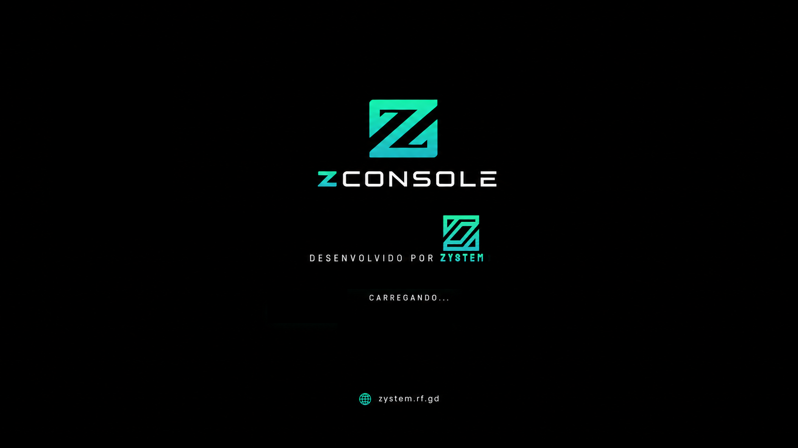

# ZConsole OS

> O sistema operacional do projeto Z-Console: uma plataforma aberta de jogos para computadores, criada para evoluir junto com o launcher, o formato ZCARD e as ferramentas da comunidade.



## Sobre o projeto

O **Z-Console** é a iniciativa mais ampla: uma plataforma aberta que pretende aproximar sistema operacional, interface de jogos, ferramentas de desenvolvimento, mídia digital e física e, no futuro, hardware próprio. A filosofia e a visão geral estão no repositório [ZystemZ/ZConsole](https://github.com/ZystemZ/ZConsole).

Este repositório, **ZConsole OS**, cuida da imagem de sistema. Ele deriva de uma base Bazzite/Fedora Atomic com `bootc` e reúne personalizações, serviços e aplicações para uma experiência de console em hardware de PC. É um projeto em desenvolvimento — não representa, por si só, um console físico nem significa que todos os componentes previstos para a plataforma já estejam prontos.

| Projeto | Papel no ecossistema |
|---|---|
| [ZConsole](https://github.com/ZystemZ/ZConsole) | Visão, arquitetura e direção da plataforma aberta. |
| [ZConsole OS](https://github.com/ZystemZ/zconsole-os) | Imagem bootc, configurações do sistema, serviços e geração de ISO. |
| [ZGameHub](https://github.com/ZystemZ/ZGameHub) | Interface/launcher de jogos e conteúdos, também integrada nesta imagem. |
| [ZCard](https://github.com/ZystemZ/ZCard) | Formato ZCARD e ferramentas/protótipos de runtime e criação. |
| **ZCardStudio** | Ferramenta complementar de autoria de ZCARDs prevista para o ecossistema; ainda não vem instalada nem integrada como aplicativo nesta imagem. |

## O que já está integrado

### Sistema e experiência de uso

- Imagem de sistema baseada em bootc, derivada do ecossistema Bazzite/Fedora Atomic.
- Identidade visual própria, incluindo tema Plymouth com a arte de inicialização do ZConsole e wordmark utilizado no instalador Anaconda.
- Sessão gráfica com inicialização automática do Z-GAME HUB. O Hub abre em tela cheia; ao fechá-lo, a sessão do ambiente gráfico continua aberta para voltar ao desktop.
- Chromium como navegador Web do sistema, com atalho próprio no menu e acesso pelo Hub.
- Ferramentas disponíveis para organizar diretórios de ROMs e saves e detectar algumas instalações locais.

### Integração do Z-GAME HUB

A imagem compila um snapshot do projeto upstream [ZystemZ/ZGameHub](https://github.com/ZystemZ/ZGameHub). O código incorporado fica em [`build_files/z-game-hub`](build_files/z-game-hub); a origem, a revisão e o processo para atualizar o snapshot estão documentados em [`UPSTREAM.md`](build_files/z-game-hub/UPSTREAM.md).

O Hub reúne uma biblioteca local de jogos e aplicativos, navegação por teclado/controle e ações para iniciar conteúdos usando os programas instalados e configurados no computador. Entre as capacidades do Hub estão integração com launchers compatíveis, catálogo comunitário Quiver, ROMs encaminhadas a um emulador externo configurado e uma tela **ZCARD / arquivos**. A disponibilidade de cada integração depende do launcher, dos arquivos e das configurações presentes no host.

O **Z-GameStore** anterior foi mantido como componente legado e pode ser aberto pelo Hub. Ele e o catálogo do Z-GAME HUB são componentes distintos.

### ZCARD e ZCardStudio

**ZCARD** é a proposta de mídia/cartucho do ecossistema Z-Console, com uma representação digital para organizar metadados, código, recursos e regiões de dados. O projeto relacionado [ZystemZ/ZCard](https://github.com/ZystemZ/ZCard) documenta o formato e reúne implementações de referência ainda em evolução.

Na versão integrada do Z-GAME HUB, a tela **ZCARD / arquivos** permite trabalhar com cartões e conteúdos locais compatíveis: montar e inspecionar cartões, listar arquivos e gerar variantes suportadas pelo builder incorporado. O Hub reconhece cartões de projeto/diretórios, arquivos ZIP legados `.zcard`, containers `ZCF0` e conteúdos `ZUF0`, conforme a versão do formato e o manifesto presente. ROMs não são executadas como se fossem executáveis ZConsole: são encaminhadas ao emulador que o usuário configurou. Executáveis nativos só são iniciados quando compatíveis com o sistema host.

O **ZCardStudio** é a ferramenta complementar prevista para a autoria de cartões. A integração dedicada do Studio com o sistema e com o fluxo do Hub **ainda está no roadmap**; nesta imagem, a ferramenta não é instalada. Até essa integração existir, use a tela ZCARD / arquivos do Hub e consulte o projeto [ZCard](https://github.com/ZystemZ/ZCard) para as ferramentas e especificações disponíveis.

Cartuchos/leitores físicos e o armazenamento em mídia física continuam sendo objetivos de desenvolvimento; esta ISO não inclui nem promete hardware de cartucho próprio.

### Navegador, ponte local e ferramentas

- **Chromium:** navegador Web instalado no sistema, com atalho no menu e ação no Hub.
- **`zconsole-setup`:** cria a estrutura inicial de pastas para ROMs e saves e registra algumas detecções locais. Não baixa jogos, ROMs ou BIOS.
- **`zconsole-cloud-sync`:** utilitário de linha de comando para sincronizar saves com `rclone`. Requer que o usuário instale/configure o remote `zconsole_cloud`; não é uma sincronização em nuvem automática nem um serviço de conta ZConsole. Por usar `rclone sync`, revise o remote e mantenha backup antes de sincronizar, pois o destino é espelhado.
- **`zconsole-local-api.service`:** API local em `127.0.0.1:48521`, usada como ponte para interfaces locais, incluindo o trabalho de integração com o Z-Overlay. Ela fornece status/telemetria e tenta aplicar controles de volume, brilho e perfil de energia quando o hardware e os serviços correspondentes estão disponíveis. As ações OSCR atualmente detectam/preparam o estado do leitor; não afirmam ler ou gravar dados de um cartucho.

A API escuta somente em loopback; **não a publique na rede ou na Internet**. Comandos ou recursos de hardware ausentes falham de forma segura e podem aparecer como indisponíveis.

| Rota | Função atual |
|---|---|
| `GET /api/status` | Estado do sistema, telemetria e disponibilidade dos controles/leitor. |
| `POST /api/brightness` | Solicita brilho de 0 a 100 via `brightnessctl`, quando disponível. |
| `POST /api/volume` | Solicita volume de 0 a 100 via `wpctl`, quando disponível. |
| `POST /api/power-profile` | Solicita perfil Silencioso, Equilibrado ou Desempenho, quando suportado. |
| `POST /api/oscr/{action}` | Consulta/prepara ações OSCR; atualmente não lê nem altera dados do cartão. |

Steam, Heroic, Lutris, jogos comerciais, ROMs, BIOS e contas de terceiros **não são redistribuídos** por este repositório. O Hub procura conteúdos que o usuário já possui ou adiciona; respeite as licenças e os termos dos respectivos projetos e fornecedores.

## Alterações próprias deste sistema

Além de compor componentes upstream, este projeto mantém adaptações específicas do ZConsole OS:

- Containerfile e scripts para compor a imagem e instalar os componentes do sistema.
- Snapshot do ZGameHub com integração de build Linux, entrada de menu/ícone, inicialização em tela cheia, confirmação ao sair e ações para navegador e loja legada.
- Tema de boot e identidade visual do ZConsole, com assets reutilizados também no instalador.
- Chromium e associação de links Web no desktop.
- Serviços de inicialização, configuração inicial, ponte local e integração de telemetria/controles.
- Compatibilidade no build da imagem com o caminho de repositórios Fedora 45 usado pelo builder da ISO.
- Workflows de GitHub Actions para compilar, publicar e assinar a imagem de sistema, além de gerar ISO Anaconda e QCOW2.

As mudanças específicas do sistema ficam neste repositório; melhorias gerais do launcher, do formato de cartões ou de outros componentes devem ser acompanhadas também nos respectivos projetos upstream.

## Direção e integrações futuras

A visão publicada no repositório [ZConsole](https://github.com/ZystemZ/ZConsole) inclui os itens abaixo. Eles são **objetivos em desenvolvimento**, sem promessa de disponibilidade ou prazo; não devem ser confundidos com recursos já entregues nesta imagem:

- **ZCardStudio:** fluxo de autoria mais completo, conectado às especificações e ferramentas do ZCARD.
- **SDK e API de jogos do Z-Console:** ferramentas/documentação para que desenvolvedores criem e integrem jogos e acessórios.
- **Launcher, catálogo/loja e serviços online** mais integrados à plataforma, complementando o Z-GAME HUB e o Z-GameStore existentes.
- **Controles, firmware e hardware aberto**, incluindo pesquisa de leitor e mídia física ZCARD e eventual suporte a mídia óptica.
- **Atualizações do sistema, perfis e saves em nuvem** com configuração e comportamento seguros e explícitos.
- **Compatibilidade e ferramentas para jogos:** evolução de emulação, suporte a jogos nativos e investigação de fluxos Proton/Vulkan conforme os projetos e licenças permitirem.
- **Comunidade, documentação e extensibilidade:** facilitar contribuições, criação de jogos, acessórios e adaptações pela comunidade.

O princípio é integrar por etapas: preferir formatos e interfaces documentados, preservar o controle do usuário sobre jogos e saves e identificar claramente quais serviços dependem de terceiros.

## Como compilar e testar

### Ferramentas

O fluxo de desenvolvimento utiliza Git, [Podman](https://podman.io/), [`just`](https://just.systems/) e as ferramentas definidas no repositório. O build do Hub utiliza CMake, Ninja, C++ e Qt 6. O pipeline de publicação usa GitHub Actions e o GitHub Container Registry (GHCR); a assinatura da imagem utiliza Cosign.

### Comandos locais

Na raiz do repositório:

```bash
just check       # valida a sintaxe do Justfile
just lint        # roda ShellCheck nos scripts Bash
just build       # compila a imagem de sistema localmente
just build-iso   # tenta gerar uma ISO a partir da imagem local
just build-qcow2 # gera uma imagem QCOW2 para máquina virtual
```

A geração de imagens de disco requer Podman e permissões/configuração compatíveis com o builder. Os comandos locais são destinados a desenvolvimento; para artifacts de distribuição, use o workflow do GitHub Actions.

### ISO para baixar

1. Abra o workflow [Build disk images](https://github.com/ZystemZ/zconsole-os/actions/workflows/build-disk.yml) e escolha **Run workflow** na branch `main`.
2. Selecione `amd64` ou `arm64` conforme o computador-alvo. A geração de ISO é demorada e requer que o build da imagem mais recente tenha terminado.
3. Na execução concluída, baixe o artifact **`artifact-anaconda-iso`** e extraia o `.iso` do ZIP. Para máquinas virtuais, baixe **`artifact-qcow2`**.
4. Os artifacts do Actions são temporários e ficam disponíveis por 30 dias. A criação de GitHub Release público é opcional e permanece desativada por padrão.

Para instalação em hardware real, verifique os requisitos de armazenamento, faça backup dos dados e confira cuidadosamente o disco selecionado pelo instalador antes de prosseguir.

## Organização do repositório

| Caminho | Conteúdo |
|---|---|
| [`Containerfile`](Containerfile) | Definição da imagem bootc do ZConsole OS. |
| [`build_files/build.sh`](build_files/build.sh) | Personalizações, pacotes, serviços e build/instalação do Hub. |
| [`build_files/z-game-hub`](build_files/z-game-hub) | Snapshot upstream do ZGameHub incorporado ao build. |
| [`system_files`](system_files) | Assets de identidade, aplicações e unidades do sistema. |
| [`disk_config`](disk_config) | Configuração de ISO e imagens de disco. |
| [`.github/workflows/build.yml`](.github/workflows/build.yml) | Build, publicação e assinatura da imagem. |
| [`.github/workflows/build-disk.yml`](.github/workflows/build-disk.yml) | Geração e upload dos artifacts de disco/ISO. |
| [`Justfile`](Justfile) | Comandos locais usados no desenvolvimento e nos builds. |

## Contribuição e licenças

Contribuições em sistema, launcher, formatos, ferramentas, hardware e documentação são bem-vindas. Para mudanças no snapshot do Hub, consulte [`UPSTREAM.md`](build_files/z-game-hub/UPSTREAM.md) e mantenha as adaptações necessárias ao sistema. Antes de redistribuir código ou assets, consulte a licença deste repositório, dos componentes incorporados e dos projetos upstream; cada componente pode ter seus próprios termos.
